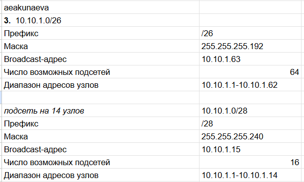
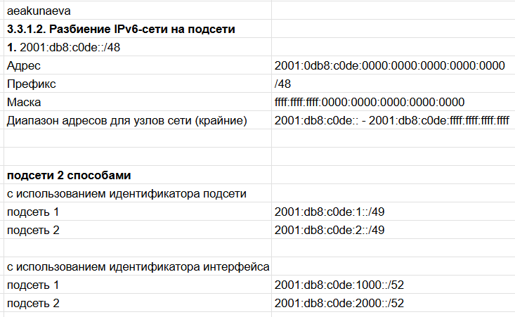

---
## Front matter
lang: ru-RU
title: Лабораторная работа №3
subtitle: Адресация IPv4 и IPv6
author:
  - Акунаева Антонина Эрдниевна
institute:
  - Российский университет дружбы народов, Москва, Россия
  
date: 2026-10-10

## i18n babel
babel-lang: russian
babel-otherlangs: english

## Formatting pdf
toc: false
toc-title: Содержание
slide_level: 2
aspectratio: 169
section-titles: true
theme: metropolis
header-includes:
 - \metroset{progressbar=frametitle,sectionpage=progressbar,numbering=fraction}
---

# Информация

## Докладчик

:::::::::::::: {.columns align=center}
::: {.column width="70%"}

  * Акунаева Антонина Эрдниевна
  * студент ФФМиЕН, НПИбд-02-24
  * Российский университет дружбы народов
  * [1032240492@rudn.ru](mailto:1032240492@rudn.ru)
  * <https://github.com/Akuxee>

:::
::: {.column width="30%"}

:::
::::::::::::::

# Цели и задачи

- Изучение принципов организации адресного пространства.  

**3.3.1.1. Разбиение IPv4-сети на подсети**  

1. Задана IPv4-сеть 172.16.20.0/24. Для заданной сети определите префикс, маску, broadcast-адрес, число возможных подсетей, диапазон адресов узлов. Разбейте сеть на 3 подсети с максимально возможным числом адресов узлов 126, 62, 62 соответственно.  

2. Задана сеть 10.10.1.64/26. Для заданной сети определите префикс, маску, broadcast-адрес, число возможных подсетей, диапазон адресов узлов. Выделите в этой сети подсеть на 30 узлов. Запишите характеристики для выделенной подсети.  

3. Задана сеть 10.10.1.0/26. Для этой сети определите префикс, маску, broadcast-адрес, число возможных подсетей, диапазон адресов узлов. Выделите в этой сети подсеть на 14 узлов. Запишите характеристики для выделенной подсети.  

# Цели и задачи

**3.3.1.2. Разбиение IPv6-сети на подсети**  

1. Задана сеть 2001:db8:c0de::/48. Охарактеризуйте адрес, определите маску, префикс, диапазон адресов для узлов сети (краевые значения). Разбейте сеть на 2 подсети двумя способами — с использованием идентификатора подсети и с использованием идентификатора интерфейса. Поясните предложенные вами варианты разбиения.  

2. Задана сеть 2a02:6b8::/64. Охарактеризуйте адрес, определите маску, префикс, диапазон адресов для узлов сети (краевые значения). Разбейте сеть на 2 подсети двумя способами — с использованием идентификатора подсети и с использованием идентификатора интерфейса. Поясните предложенные вами варианты разбиения.  

# Материалы и методы

- Linux Fedora Workstation (Markdown)
- Google Таблицы

# Выполнение лабораторной работы

## IPv4: Задание 1

{#fig:001 width=70%}

## IPv4: Задание 2

{#fig:002 width=70%}

## IPv4: Задание 3

{#fig:003 width=70%}

## IPv6: Задание 1

{#fig:004 width=70%}

## IPv6: Задание 2

{#fig:005 width=70%}

# Выводы

Я изучила принципы организации адресного пространства.

