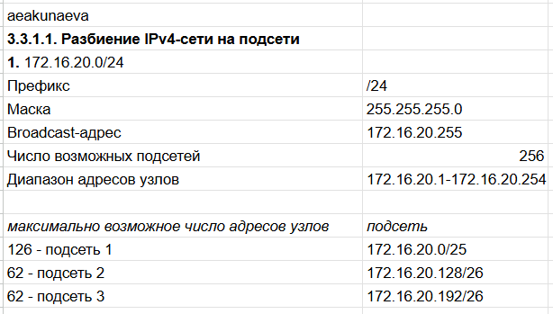
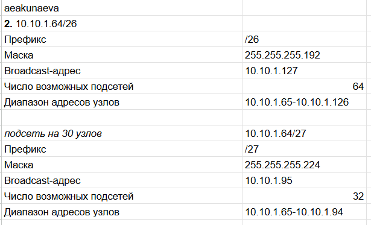
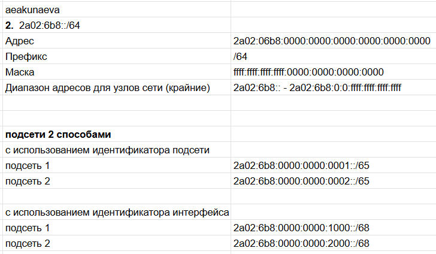

---
## Front matter
title: "Отчёт по лабораторной работе №3"
subtitle: "Адресация IPv4 и IPv6"
author: "Акунаева Антонина Эрдниевна"

## Generic otions
lang: ru-RU
toc-title: "Содержание"

## Bibliography
bibliography: bib/cite.bib
csl: pandoc/csl/gost-r-7-0-5-2008-numeric.csl

## Pdf output format
toc: true # Table of contents
toc-depth: 2
lof: true # List of figures
lot: true # List of tables
fontsize: 12pt
linestretch: 1.5
papersize: a4
documentclass: scrreprt
## I18n polyglossia
polyglossia-lang:
  name: russian
  options:
	- spelling=modern
	- babelshorthands=true
polyglossia-otherlangs:
  name: english
## I18n babel
babel-lang: russian
babel-otherlangs: english
## Fonts
mainfont: IBM Plex Serif
romanfont: IBM Plex Serif
sansfont: IBM Plex Sans
monofont: IBM Plex Mono
mathfont: STIX Two Math
mainfontoptions: Ligatures=Common,Ligatures=TeX,Scale=0.94
romanfontoptions: Ligatures=Common,Ligatures=TeX,Scale=0.94
sansfontoptions: Ligatures=Common,Ligatures=TeX,Scale=MatchLowercase,Scale=0.94
monofontoptions: Scale=MatchLowercase,Scale=0.94,FakeStretch=0.9
mathfontoptions:
## Biblatex
biblatex: true
biblio-style: "gost-numeric"
biblatexoptions:
  - parentracker=true
  - backend=biber
  - hyperref=auto
  - language=auto
  - autolang=other*
  - citestyle=gost-numeric
## Pandoc-crossref LaTeX customization
figureTitle: "Рис."
tableTitle: "Таблица"
listingTitle: "Листинг"
lofTitle: "Список иллюстраций"
lotTitle: "Список таблиц"
lolTitle: "Листинги"
## Misc options
indent: true
header-includes:
  - \usepackage{indentfirst}
  - \usepackage{float} # keep figures where there are in the text
  - \floatplacement{figure}{H} # keep figures where there are in the text
---

# Цель работы

Изучение принципов организации адресного пространства. [@TUIS-lab]

# Задание

**3.3.1. Разбиение сети на подсети**  

**3.3.1.1. Разбиение IPv4-сети на подсети**  

1. Задана IPv4-сеть 172.16.20.0/24. Для заданной сети определите префикс, маску, broadcast-адрес, число возможных подсетей, диапазон адресов узлов. Разбейте сеть на 3 подсети с максимально возможным числом адресов узлов 126, 62, 62 соответственно.  

2. Задана сеть 10.10.1.64/26. Для заданной сети определите префикс, маску, broadcast-адрес, число возможных подсетей, диапазон адресов узлов. Выделите в этой сети подсеть на 30 узлов. Запишите характеристики для выделенной подсети.  

3. Задана сеть 10.10.1.0/26. Для этой сети определите префикс, маску, broadcast-адрес, число возможных подсетей, диапазон адресов узлов. Выделите в этой сети подсеть на 14 узлов. Запишите характеристики для выделенной подсети.  

**3.3.1.2. Разбиение IPv6-сети на подсети**  

1. Задана сеть 2001:db8:c0de::/48. Охарактеризуйте адрес, определите маску, префикс, диапазон адресов для узлов сети (краевые значения). Разбейте сеть на 2 подсети двумя способами — с использованием идентификатора подсети и с использованием идентификатора интерфейса. Поясните предложенные вами варианты разбиения.  

2. Задана сеть 2a02:6b8::/64. Охарактеризуйте адрес, определите маску, префикс, диапазон адресов для узлов сети (краевые значения). Разбейте сеть на 2 подсети двумя способами — с использованием идентификатора подсети и с использованием идентификатора интерфейса. Поясните предложенные вами варианты разбиения.  

# Выполнение лабораторной работы

**3.3.1.1. Разбиение IPv4-сети на подсети**  

Для заданной IPv4-сети определяем префикс: он расположен в самом конце после /, т.е. /24 ([рис. @fig:001]).  

Маска вычисляется по следующему принципу: в IPv4 на адрес выделено 32 бита, 24 битов (из префикса) отдаются для обозначения адреса сети, остальные - для узлов. Каждый блок (октет), разделённый от других точками, состоит из 8 битов, 24 / 8 = 3 октета для сети будут обозначаться единицами, остальное - нулями, потому маска будет 255.255.255.0, т.к. 11111111 в двоичном виде будет складываться в 255 (128+64+32+16+8+2+1+0 для каждой единицы соответственно).  

Broadcast-адрес захватывает последний октет в данном адресе, т.е. оставшиеся 8 битов (32 - 24 = 8). Всего адресов может быть 2^n, где n = 8, потому 2^8=256 (число возможных подсетей), broadcast является последним из возможных адресов, а т.к. отсчёт адресов начинается с 0, то последним будет 255: 172.16.20.255.  

Диапазон адресов узлов не учитывает исходный адрес сети и broadcast (последний), потому будет равен 172.16.20.1 - 172.16.20.254.  

Для разбиения сети на 3 подсети с максимально возможными числами адресов узлов 126, 62, 62, определим префикс:

1. 126 адресов узлов доступно в первом случае, ещё 2 это исходный и broadcast, тогда всего 128 = 2^7 => n = 7, от 32 битов для IPv4 отнимаем n = 7: 32 - 7 = 25 - префикс, столько определено битов для адреса сети. Начинаем отсчёт первой подсети с 0, поэтому будет 172.16.20.0/25.  

2. Для следующей подсети 62 узла, значит всего 64 = 2^6 => n = 6 => 32 - 6 = 26 - префикс. Для первой подсети существует 128 адресов всего, начиная с 0, тогда вторая подсеть начнёт отсчёт с 128: 172.16.20.128/26.  

3. Третья подсеть имеет параметры практически аналогично второй (префикс = 26), но у второй подсети всего 64 адреса, начиная с 128 => 128 + 64 = 192 будет первым адресом для третьей подсети: 172.16.20.192/26:

{#fig:001 width=70%}

Аналогично предыдущему заданию, считаем второе. Префикс /26, значит 26 битов под адреса сети, т.е. на четвёртом октете будет 11000000 = 192 (128+64), остальные равны единицам, т.е. 255: 255.255.255.192 маска ([рис. @fig:002]).  

32 - 26 = 6 = n => 2^6 = 64 возможных подсетей, так что берём последний для broadcast-адреса, прибавляя к значению четвёртого октета 64 и отнимая 1, т.к. начинаем с 0: 10.10.1.127 (64+64-1 = 127), тогда диапазон доступных адресов узлов, не считая исходного и broadcast: 10.10.1.65-10.10.1.126.  

Подсеть на 30 узлов будет иметь +2 адреса подсетей это исходный и broadcast, поэтому число возможных подсетей 32, а 2^5 = 32 => n = 5, тогда префикс = 32 - 5 = 27, маска тогда равна 255.255.255.224 (128+64+32 = 224, т.к. 11100000 в последнем октете). Broadcast-адрес вычисляется прибавлением к значению последнего октета 64 + 32 - 1 = 95: 10.10.1.95, тогда диапазон адресов узлов: 10.10.1.65 - 10.10.1.94:

{#fig:002 width=70%}

Префикс следующей сети /26, тогда маска 255.255.255.192 аналогично вычислениям выше; число возможных подсетей = 2^n, где n = 32 - 26 = 6 => 2^6 = 64, тогда последний адрес (broadcast) 10.10.1.63, т.к. начинаем с 0, а диапазон адресов узлов: 10.10.1.1 - 10.10.1.62 ([рис. @fig:003]).  

Подсеть на 14 узлов будет иметь ещё 2 (исхожный и broadcast), так что число возможных подсетей = 16, тогда broadcast-адрес 10.10.1.15, а диапазон: 10.10.1.1 - 10.10.1.14. Префикс определяем: 16 = 2^4 => n = 4, 32 - 4 = 28, следовательно маска 255.255.255.240 (т.к. двоичная запись 11110000):

{#fig:003 width=70%}

**3.3.1.2. Разбиение IPv6-сети на подсети**  

Для сети IPv6 распишем полный адрес в шестнадцатиречной системе счисления, раскрывая :: как 0000:0000..., всего восемь блоков с 4 значениями в каждом (недостающие равны 0), потому полный адрес - 2001:0db8:c0de:0000:0000:0000:0000:0000 ([рис. @fig:004]).  

Префикс обозначен также после / - /48. Маска тогда высчитывается по 16 битов от 48: 48 / 16 = 3, значит три блока будут равны единицам (под адрес сети), остальные нулям (под узлы), а единицы для 16-ой системы это F - FFFF:FFFF:FFFF:0000:0000:0000:0000:0000.  

Диапазон адресов для узлов сети, включая крайние тогда от 0 до макс. с единицами (FFFF) - 2001:db8:c0de:: - 2001:db8:c0de:FFFF:FFFF:FFFF:FFFF:FFFF.  

Разделяем сеть на подсеть двумя способнами:  

1. *с использованием идентификатора подсети* - для этого после выделенных 48 битов выделяем хотя бы 1 бит (префикс будет 49, мы его расширяем), чтобы  записать для каждой подсети номер, например, 1 и 2: 2001:db8:c0de:1::/49 и 2001:db8:c0de:2::/49.  

2. *с использованием идентификатора интерфейса* - здесь мы расширяем префикс за счёт битов поля интерфейса, обычно добавляя полбайта (4 бита) к имеющимся в префиксе, тогда префикс 48+4 = 52, а подсети будут отличаться друг от друга по гексету - 2001:db8:c0de:1000::/52 и 2001:db8:c0de:2000::/52 соответственно.  

{#fig:004 width=70%}

Аналогично предыдущему заданию расписываем адрес, расшифровывая :: в 0000, префикс равен /64, т.е. 64 / 16 = 4 гексета будут равны единицам => маска = FFFF:FFFF:FFFF:FFFF:0000:0000:0000:0000, а крайний диапазон 2a02:6b8:: - 2a02:6b8:0:0:FFFF:FFFF:FFFF:FFFF ([рис. @fig:005]).  

Разделяем сеть на подсеть двумя способнами:  

1. *с использованием идентификатора подсети* - прибавляем 1 бит к префиксу (64 + 1 = 65) и добавляем номер подсети: 2a02:6b8:0000:0000:0001::/65 и 2a02:6b8:0000:0000:0002::/65.  

2. *с использованием идентификатора интерфейса* - прибавляем 4 бита от интерфейса (64 + 4 = 68 новый префикс), тогда: 2a02:6b8:0000:0000:1000::/68 и 2a02:6b8:0000:0000:2000::/68.

{#fig:005 width=70%}

# Выводы

Я изучила принципы организации адресного пространства.

# Список литературы{.unnumbered} 

::: {#refs}
:::
