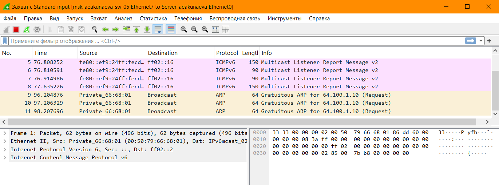
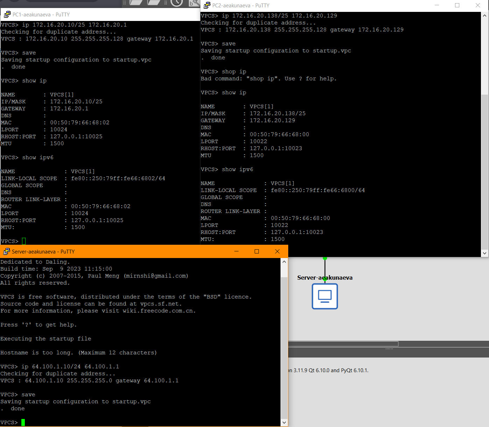
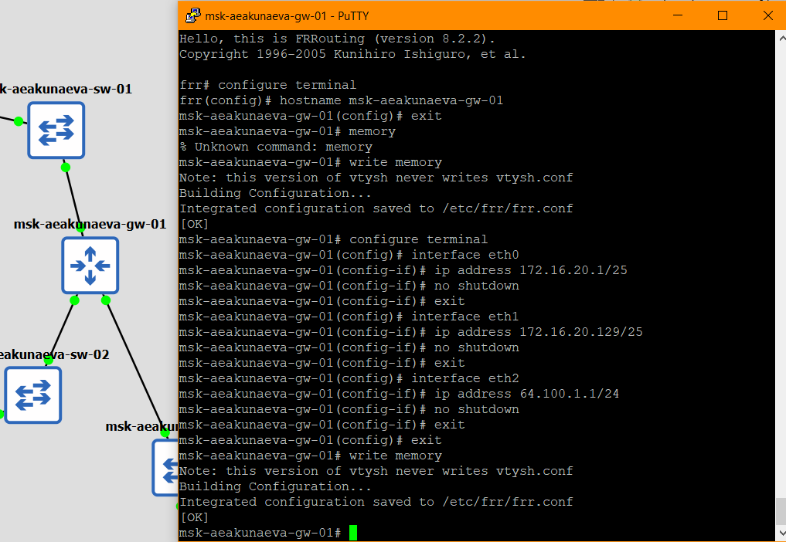
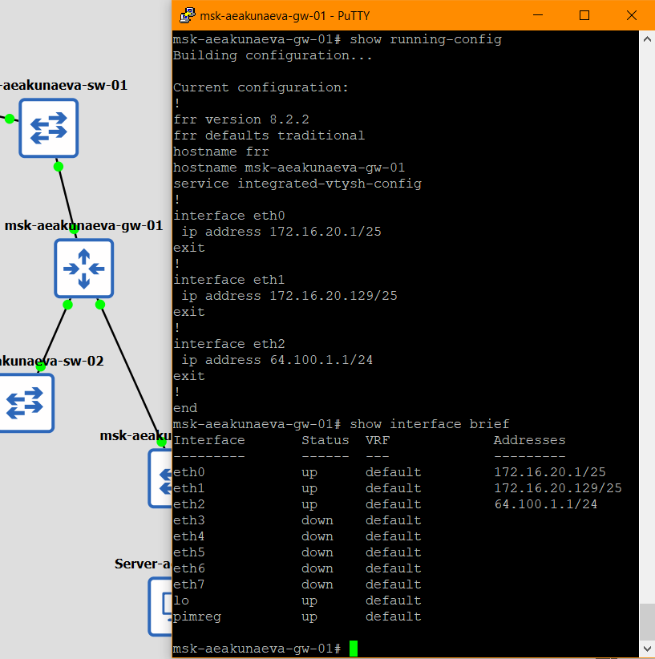
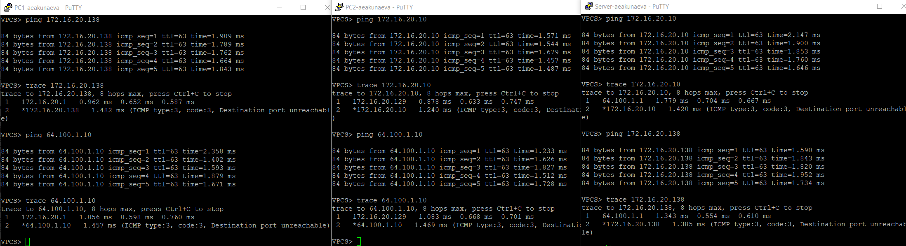
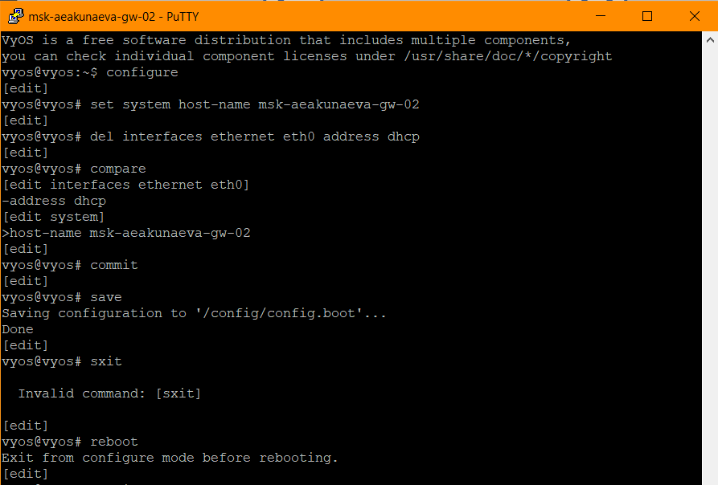
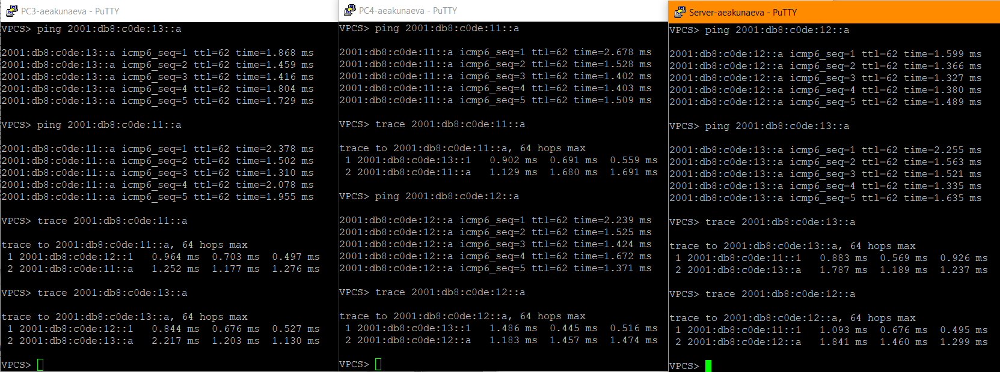
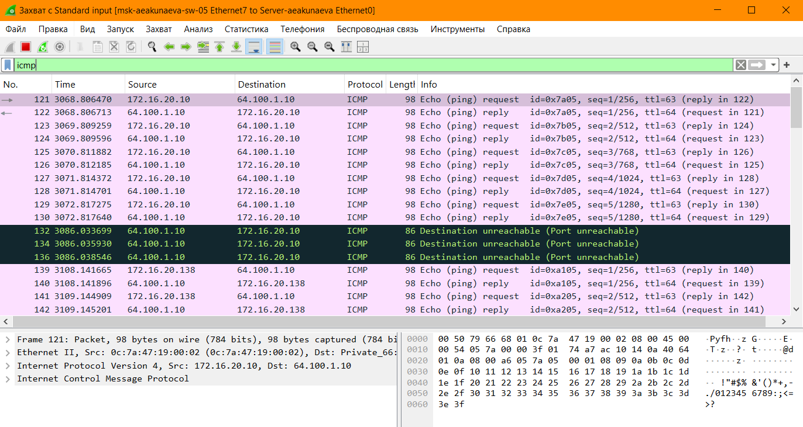

---
## Front matter
lang: ru-RU
title: Лабораторная работа №4
subtitle: Адресация IPv4 и IPv6. Двойной стек
author:
  - Акунаева Антонина Эрдниевна
institute:
  - Российский университет дружбы народов, Москва, Россия
  
date: 2026-10-24

## i18n babel
babel-lang: russian
babel-otherlangs: english

## Formatting pdf
toc: false
toc-title: Содержание
slide_level: 2
aspectratio: 169
section-titles: true
theme: metropolis
header-includes:
 - \metroset{progressbar=frametitle,sectionpage=progressbar,numbering=fraction}
---

# Информация

## Докладчик

:::::::::::::: {.columns align=center}
::: {.column width="70%"}

  * Акунаева Антонина Эрдниевна
  * студент ФФМиЕН, НПИбд-02-24
  * Российский университет дружбы народов
  * [1032240492@rudn.ru](mailto:1032240492@rudn.ru)
  * <https://github.com/Akuxee>

:::
::: {.column width="30%"}

:::
::::::::::::::

# Цели и задачи

- Изучение принципов распределения и настройки адресного пространства на устройствах сети.

1. реализовать топологию сети в GNS3;  

2. настроить IPv4-адресацию на устройствах первой подсети и проверить подключение между устройствами этой подсети;  

3. настроить IPv6-адресацию на устройствах второй подсети и проверить подключение между устройствами этой подсети;  

4. проанализировать захваченный на соединении сервера двойного стека адресации с коммутатором трафик ARP, ICMP, ICMPv6.  

# Материалы и методы

- Linux Fedora Workstation (Markdown)
- Oracle VirtualBox 7.2.16
- GNS3 VM 3.0.6
- GNS3 3.0.6
- Wireshark

# Выполнение лабораторной работы

## Топология сети в GNS3

{#fig:001 width=70%}

## Захват трафика между сервером и коммутатором в Wireshark

{#fig:002 width=70%}

## Настройка IPv4-адресации узлов

{#fig:003 width=70%}

## Настройка IPv4-адресации маршрутизатора FRR

{#fig:004 width=70%}

## Проверка конфигурации маршрутизатора и настройки IPv4-адресации

{#fig:005 width=70%}

## Проверка подключения IPv4-узлов

{#fig:006 width=70%}

## Настройка IPv6-адресации узлов

{#fig:007 width=70%}

## Настройка IPv6-адресации маршрутизатора VyOS

{#fig:008 width=70%}

## Назначение IPv6-адреса маршрутизатору VyOS

{#fig:009 width=70%}

## Отображение интерфейсов маршрутизатора VyOS

{#fig:010 width=70%}

## Проверка подключения IPv6-узлов

{#fig:011 width=70%}

## Проверка отсутствия передачи пакетов между IPv4 и IPv6

{#fig:012 width=70%}

## Захваченный трафик ARP на сервере

{#fig:013 width=70%}

## Захваченный трафик ICMP на сервере

{#fig:014 width=70%}

## Захваченный трафик ICMPv6 на сервере

{#fig:015 width=70%}

## Топология сети в GNS3 для сам. выполнения

{#fig:016 width=70%}

## Проверка подключения узлов

{#fig:016 width=70%}

# Выводы

Я изучила принципы распределения и настройки адресного пространства на устройствах сети.

