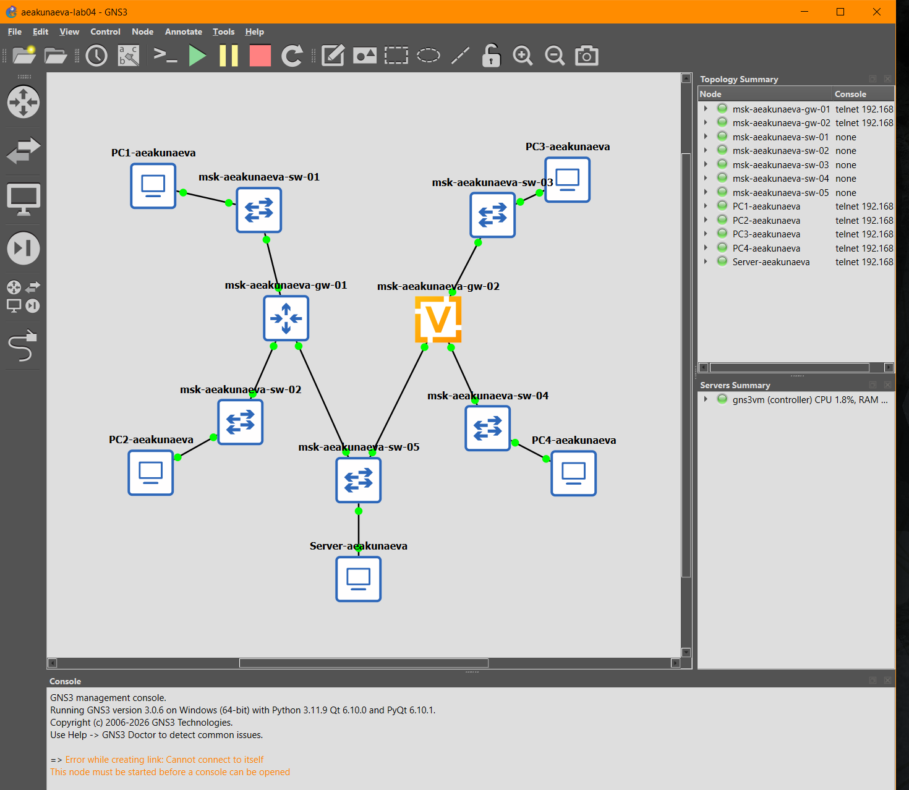
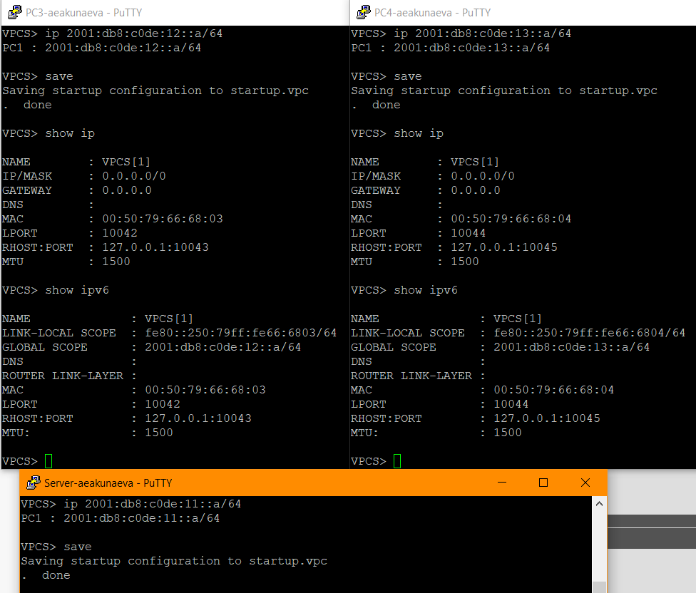
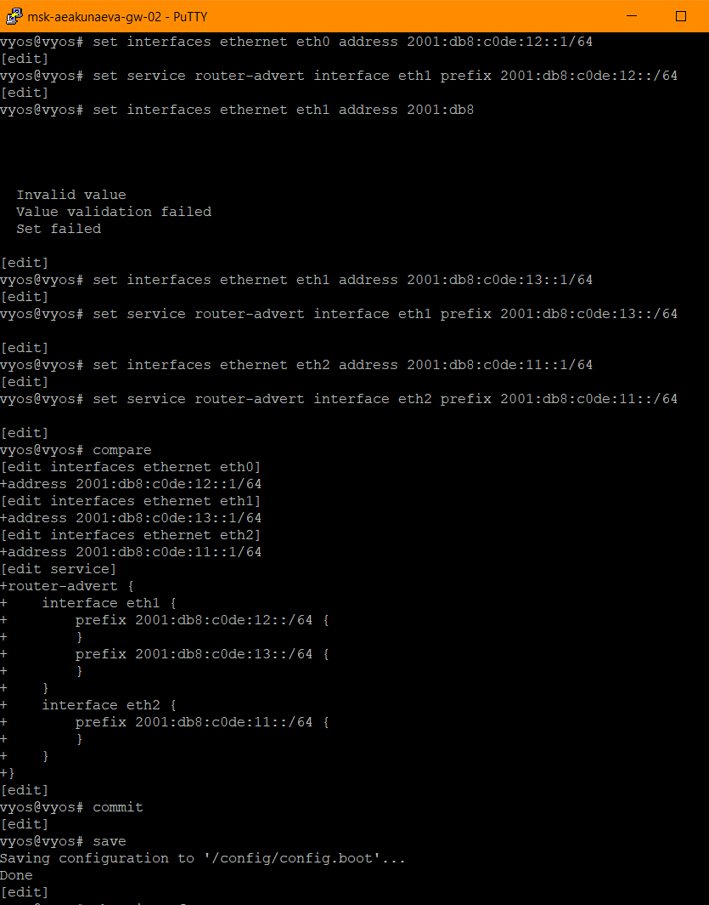
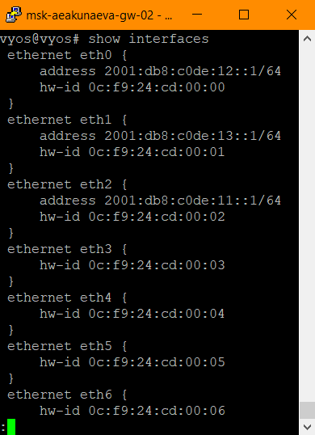
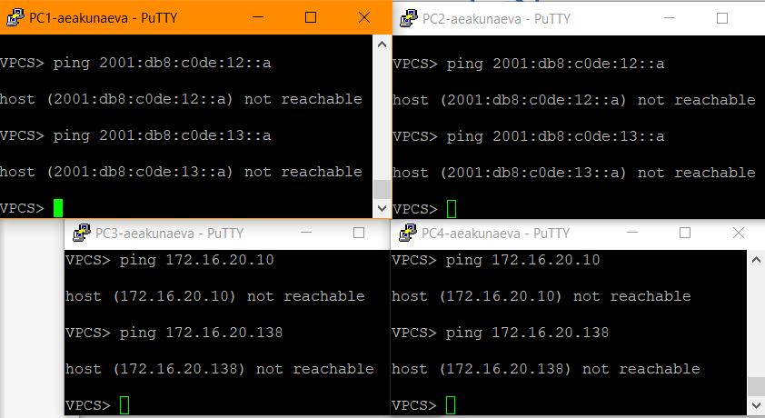
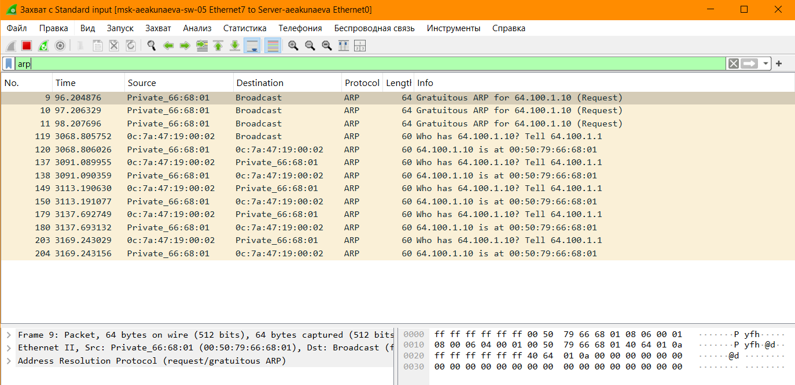
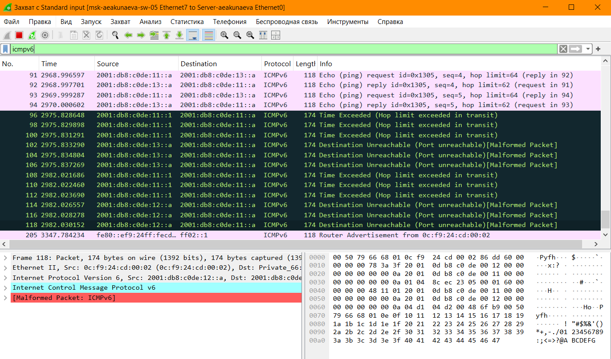
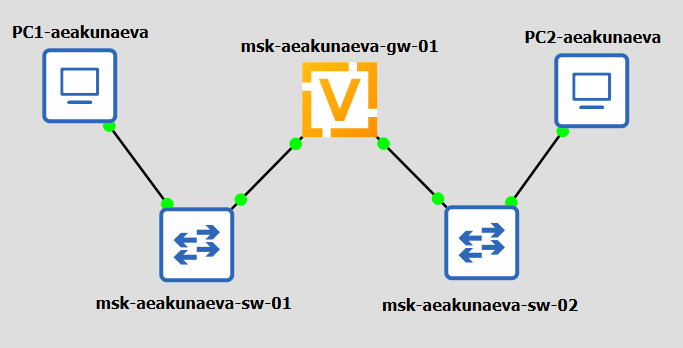
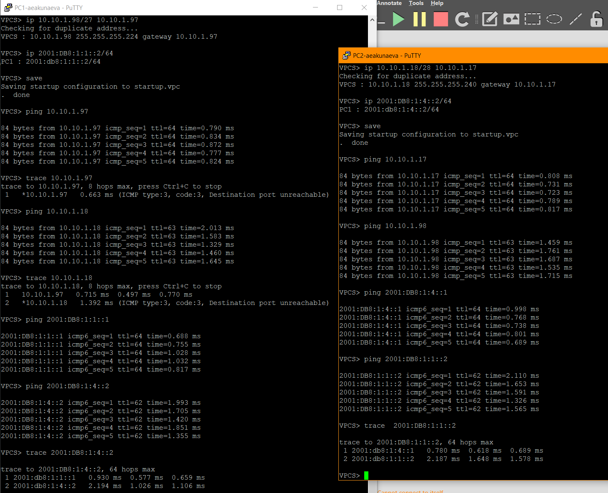

---
## Front matter
title: "Отчёт по домашней работе №4"
subtitle: "Адресация IPv4 и IPv6. Двойной стек"
author: "Акунаева Антонина Эрдниевна"

## Generic otions
lang: ru-RU
toc-title: "Содержание"

## Bibliography
bibliography: bib/cite.bib
csl: pandoc/csl/gost-r-7-0-5-2008-numeric.csl

## Pdf output format
toc: true # Table of contents
toc-depth: 2
lof: true # List of figures
lot: true # List of tables
fontsize: 12pt
linestretch: 1.5
papersize: a4
documentclass: scrreprt
## I18n polyglossia
polyglossia-lang:
  name: russian
  options:
	- spelling=modern
	- babelshorthands=true
polyglossia-otherlangs:
  name: english
## I18n babel
babel-lang: russian
babel-otherlangs: english
## Fonts
mainfont: IBM Plex Serif
romanfont: IBM Plex Serif
sansfont: IBM Plex Sans
monofont: IBM Plex Mono
mathfont: STIX Two Math
mainfontoptions: Ligatures=Common,Ligatures=TeX,Scale=0.94
romanfontoptions: Ligatures=Common,Ligatures=TeX,Scale=0.94
sansfontoptions: Ligatures=Common,Ligatures=TeX,Scale=MatchLowercase,Scale=0.94
monofontoptions: Scale=MatchLowercase,Scale=0.94,FakeStretch=0.9
mathfontoptions:
## Biblatex
biblatex: true
biblio-style: "gost-numeric"
biblatexoptions:
  - parentracker=true
  - backend=biber
  - hyperref=auto
  - language=auto
  - autolang=other*
  - citestyle=gost-numeric
## Pandoc-crossref LaTeX customization
figureTitle: "Рис."
tableTitle: "Таблица"
listingTitle: "Листинг"
lofTitle: "Список иллюстраций"
lotTitle: "Список таблиц"
lolTitle: "Листинги"
## Misc options
indent: true
header-includes:
  - \usepackage{indentfirst}
  - \usepackage{float} # keep figures where there are in the text
  - \floatplacement{figure}{H} # keep figures where there are in the text
---


# Цель работы

Изучение принципов распределения и настройки адресного пространства на устройствах сети. [@TUIS-lab][@tanenbaum_book_modern-os_ru]

# Задание

- реализовать топологию сети в GNS3;  

- настроить IPv4-адресацию на устройствах первой подсети и проверить подключение между устройствами этой подсети;  

- настроить IPv6-адресацию на устройствах второй подсети и проверить подключение между устройствами этой подсети;  

- проанализировать захваченный на соединении сервера двойного стека адресации с коммутатором трафик ARP, ICMP, ICMPv6.  

# Выполнение лабораторной работы

Запускаем GNS3 VM и GNS3, создаём новый проект (например, lab04-aeakunaeva).  

Размещаем устройства в соответствии с топологией из файла лабораторной работы и соединяем их сетью. НАименовываем каждый эелмент в соответствии с требованиями, указывая наш логин (в данном случае aeakunaeva). Включаем захват трафика на ПКМ на соединении между сервером двойного стека адресации и коммутатором msk-aeakunaeva-sw-05 (откроется окно Wireshark). Запустим все подключения и откроем для каждого из устройств PCx и маршрутизаторов консоли на ПКМ (для IPv4 PC1 и PC2 должен стоять маршрутизатор FRR, для PC3 и PC4 - VyOS) ([рис. @fig:001]-[рис. @fig:002])[@robbins_book_bash_en]:

{#fig:001 width=70%}

{#fig:002 width=70%}

Настраиваем IPv4-адресацию узлов для PC1, PC2, Server ([рис. @fig:003]):

– PC1:  

```
ip 172.16.20.10/25 172.16.20.1
save
```

– PC2:  

```
ip 172.16.20.138/25 172.16.20.129
save
```

– Server:  
```
ip 64.100.1.10/24 64.100.1.1
save
```

Посмотрим на PC1 и PC2 конфигурацию IPv4 и IPv6:  

```
show ip
show ipv6
```

Все настройки успешно заданы, как показывают команды shop ip/ipv6.

{#fig:003 width=70%}

Настроим IPv4-адресацию для интерфейсов локальной сети маршрутизатора FRR msk-aeakunaeva-gw-01 ([рис. @fig:004]):

```
configure terminal
hostname msk-aeakunaeva-gw-01
exit
rite memory
configure terminal
interface eth0
ip address 172.16.20.1/25
no shutdown
exit

interface eth1
ip address 172.16.20.129/25
no shutdown
exit

interface eth2
ip address 64.100.1.1/24
no shutdown
exit
exit
write memory
```

{#fig:004 width=70%}

Проверим конфигурацию маршрутизатора и настройки IPv4-адресации. Убедимся, что всё настроено верно ([рис. @fig:005])[@zarrelli_book_mastering-bash_en][@newham_book_learning-bash_en]:
 
```
show running-config
show interface brief
```
 
{#fig:005 width=70%}

Пропингуем подключения PC1-PC2, PC1-Server, PC2-PC1, PC2-Server, Server-PC1, Server-PC2 и тем самым проверим подключения. В каждом терминале обратимся по адресам IPv4 к каждому из устройств на ping [адрес] и проверим через trace [адрес] ([рис. @fig:006]):

{#fig:006 width=70%}

Настраиваем IPv6-адресацию узлов для PC3, PC4, Server  ([рис. @fig:007]):

– PC3:  

```
ip 2001:db8:c0de:12::a/64
save
show ip
show ipv6
```

– PC4:  

```
ip 2001:db8:c0de:13::a/64
save
show ip
show ipv6
```

– Server:  

```
ip 2001:db8:c0de:11::a/64
save
show ip
show ipv6
```

{#fig:007 width=70%}

Настроим IPv6-адресацию для интерфейсов локальной сети маршрутизатора VyOS msk-aeakunaeva-gw-02 ([рис. @fig:008]):

```
configure
set system host-name msk-aeakunaeva-gw-02
del interfaces ethernet eth0 address dhcp
compare
commit
save
exit
reboot
```

{#fig:008 width=70%}

Назначим IPv6-адреса маршрутизатору msk-aeakunaeva-gw-02 ([рис. @fig:009]):

```
configure
set interfaces ethernet eth0 address 2001:db8:c0de:12::1/64
set service router-advert interface eth0 prefix 2001:db8:c0de:12::/64
set interfaces ethernet eth1 address 2001:db8:c0de:13::1/64
set service router-advert interface eth1 prefix 2001:db8:c0de:13::/64
set interfaces ethernet eth2 address 2001:db8:c0de:11::1/64
set service router-advert interface eth2 prefix 2001:db8:c0de:11::/64
compare
Commit
save
```

{#fig:009 width=70%}

Отобразим интерфейсы и проверим корректность ввода предыдущих данных ([рис. @fig:010]):

```
show interfaces
```

{#fig:010 width=70%}

Пропингуем (проверим подкл.чение) узлы PC3, PC4 и Server, убедимся, что пакеты проходят между каждым из них через ping и trace ([рис. @fig:011]):

{#fig:011 width=70%}

Проверим также, что узлы IPv4 не могут передавать пакеты с IPv6 и наоборот (not reachable), при этом, исходя из предыдущих проверок, с сервером передача идёт, как и от сервера к каждому из оконечных узлов ([рис. @fig:012]):

{#fig:012 width=70%}

Посмотрим на захваченный на соединении сервера двойного стека адресации с коммутатором трафик, поставив фильтры по ARP, ICMP, ICMPv6.  ([рис. @fig:013]-[рис. @fig:014]-[рис. @fig:015]).

Здесь был проанализирован сетевой трафик между сервером двойного стека адресации и коммутатором. ARP позволяет определить MAC-адрес устройства по IPv4-адресу. ICMP используется для передачи служебных сообщений и проверки доступности устройств в IPv4-сети. ICMPv6 выполняет аналогичные функции в IPv6-сети. Из перехваченных пакетов можно определить протокол, адреса отправителя и получателя, тип сообщения и данные, необходимые для анализа сетевого обмена:

{#fig:013 width=70%}

{#fig:014 width=70%}

{#fig:015 width=70%}

**4.2.2. Задание для самостоятельного выполнения**

Создаём новый проект в GNS3, расставляем нужные по топологии утройства и даём им соответствующие наименования, подключаем и запускаем подключение между ними, маршрутизатор используем VyOS ([рис. @fig:016]).
-------------------------------------------------
1. Подсеть 1: IPv4 — 10.10.1.96/27; IPv6 — 2001:DB8:1:1::/64.  

- Маска IPv4: 255.255.255.224.  
- Адрес сети: 10.10.1.96.  
- Диапазон адресов узлов: 10.10.1.97–10.10.1.126.  
- Широковещательный адрес: 10.10.1.127.  
- Количество доступных адресов узлов: 30.  
- IPv6-префикс: 2001:DB8:1:1::/64.  
-------------------------------------------------
2. Подсеть 2: IPv4 — 10.10.1.16/28; IPv6 — 2001:DB8:1:4::/64.  
- Маска IPv4: 255.255.255.240.  
- Адрес сети: 10.10.1.16.  
- Диапазон адресов узлов: 10.10.1.17–10.10.1.30.  
- Широковещательный адрес: 10.10.1.31.  
- Количество доступных адресов узлов: 14.  
- IPv6-префикс: 2001:DB8:1:4::/64.  
-------------------------------------------------

Устройство - Интерфейс - IPv4-адрес - IPv6-адрес  
-------------------------------------------------
VyOS - eth0 - 10.10.1.97/27 - 2001:DB8:1:1::1/64  
-------------------------------------------------
PC1- - NIC - 10.10.1.98/27 - 2001:DB8:1:1::2/64  
-------------------------------------------------
VyOS - eth1 - 10.10.1.17/28 - 2001:DB8:1:4::1/64  
-------------------------------------------------
PC2 - NIC - 10.10.1.18/28 - 2001:DB8:1:4::2/64  
-------------------------------------------------
- Шлюз по умолчанию для PC1: 10.10.1.97 и 2001:DB8:1:1::1.  
- Шлюз по умолчанию для PC2: 10.10.1.17 и 2001:DB8:1:4::1.  

{#fig:016 width=70%}

Настраиваем маршрутизатор VyOS (удаляем DHCP) и проводим настройку под IPv4-, IPv6-адресацию для каждого из узлов и маршрутизатора, устанавливая наименьшие адреса в подсети для них. Проверяем подклюение через ping и trace для каждого из устройств ([рис. @fig:017]):

{#fig:017 width=70%}


# Выводы

Я изучила принципы распределения и настройки адресного пространства на устройствах сети.

# Список литературы{.unnumbered} 

::: {#refs}
:::
